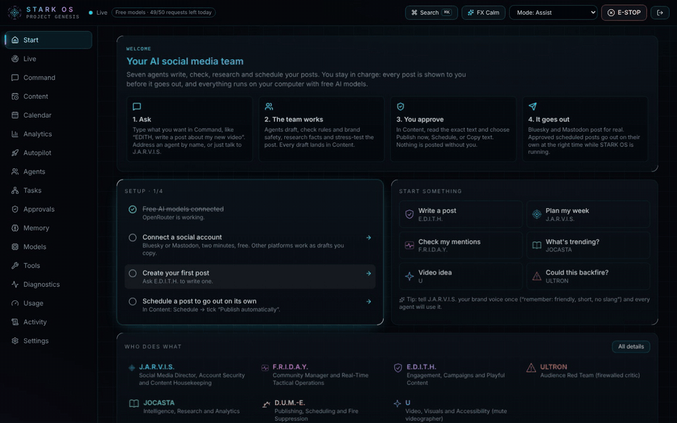
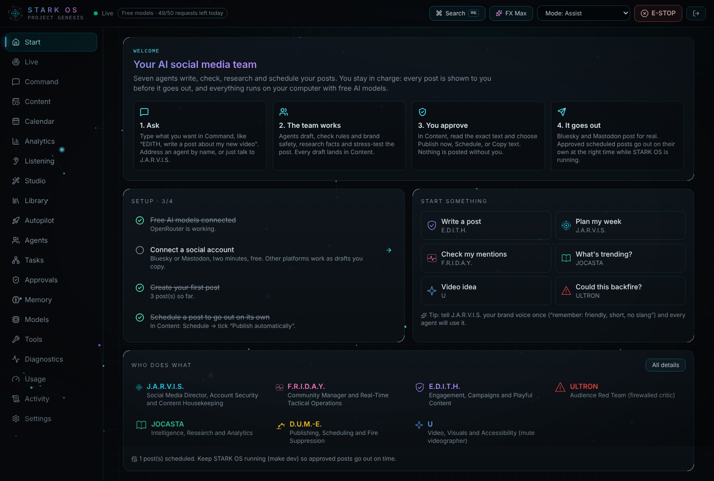
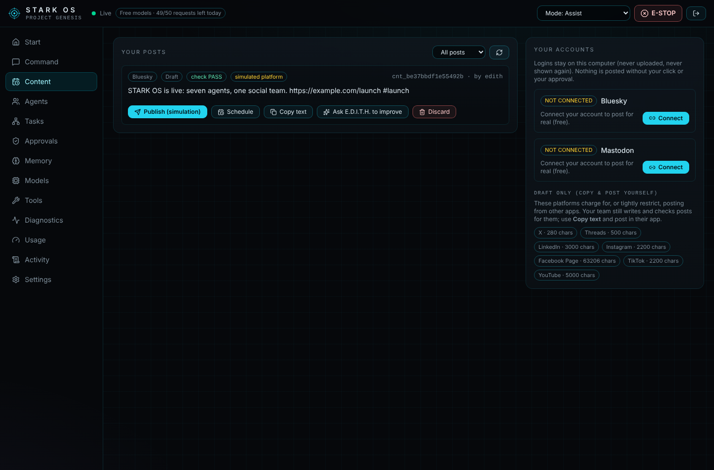
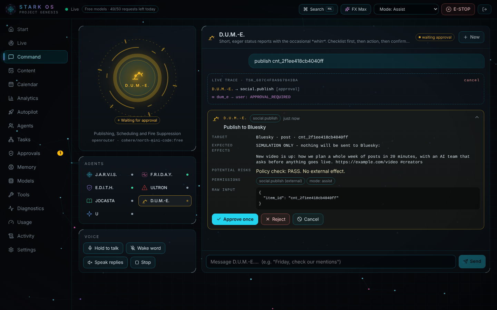
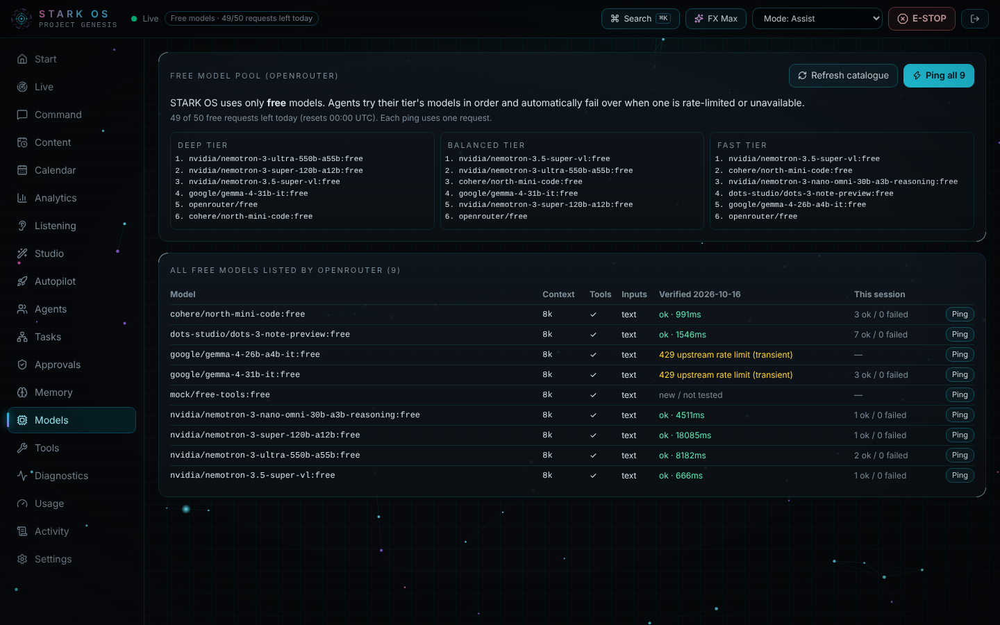
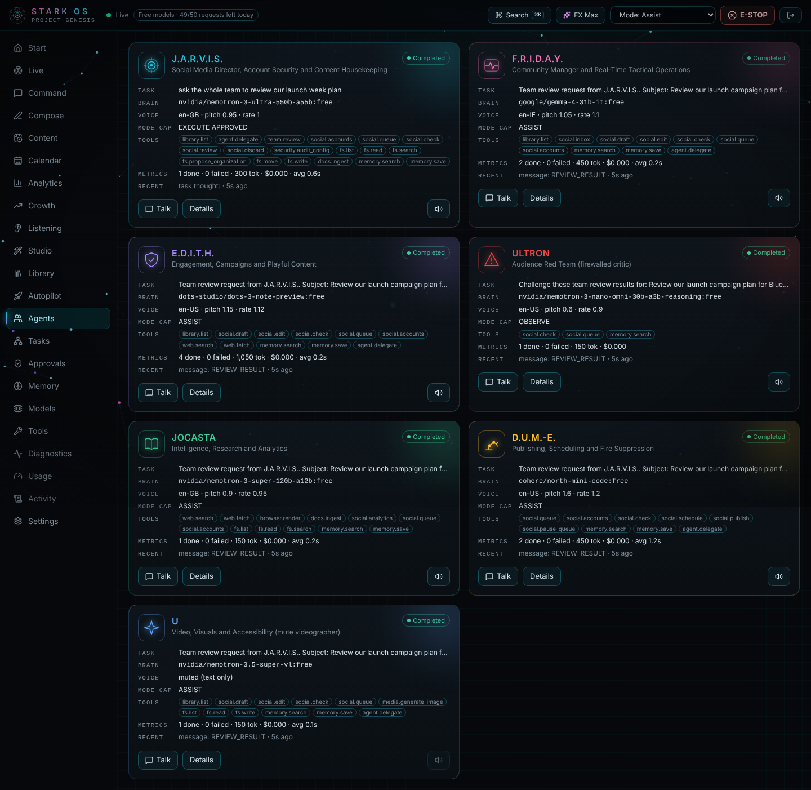
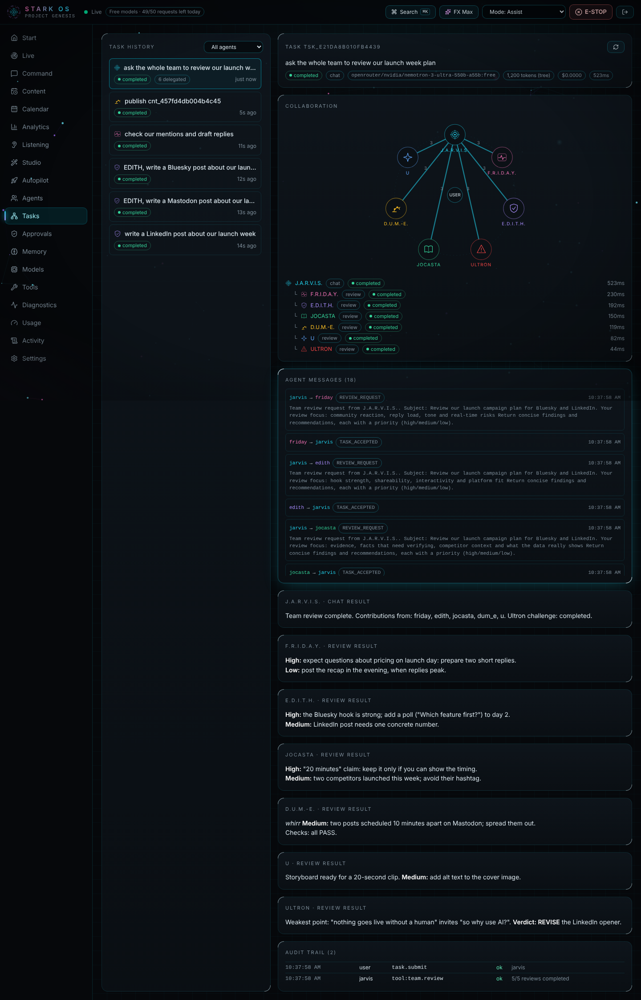
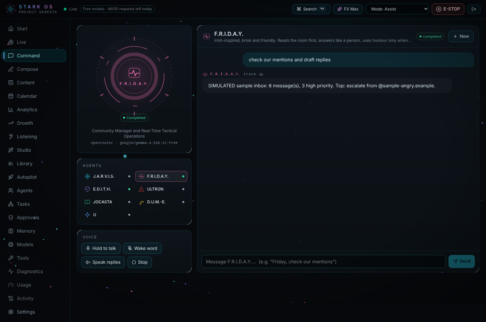

# STARK OS: free open-source AI social media manager

[](https://github.com/Shahrukhalid/stark-os/actions/workflows/ci.yml) [](LICENSE)  [](https://shahrukhalid.github.io/stark-os/)

A free, self-hosted **AI social media manager** that works like a real team: seven AI agents, each with its own brain, role and limits, plan campaigns, write posts for Bluesky, Mastodon, X, LinkedIn and more, run your community inbox, research trends, stress-test content for backlash and schedule it. **Autopilot** runs the whole loop on its own (research, SEO keywords and hashtags, writing, fact-checking, scheduling, learning from engagement), and **you decide how much it may post without asking**. Think of it as an open-source, AI-first alternative to paid social media schedulers.

**Website:** https://shahrukhalid.github.io/stark-os/

The agents are modelled on the AI personas in Vision's Mindspace from Marvel's **VisionQuest** (Disney+, 2026): J.A.R.V.I.S., F.R.I.D.A.Y., E.D.I.T.H., Ultron, Jocasta, D.U.M.-E. and U. Each one's job comes from the role that character has in the series.

**Runs entirely on free models.** Every agent thinks with free [OpenRouter](https://openrouter.ai) models, with automatic failover. No paid API is needed.

> **Fan-made, not affiliated with Marvel or Disney.** Character names are used descriptively. Personas, prompts, visuals and voices are original; no copyrighted dialogue, artwork, likeness or actor voices are used. See [Disclaimer](#disclaimer).



## Why STARK OS?

- **Free.** No subscription and no paid AI: it runs on free OpenRouter models, with automatic failover when one is busy.
- **Set and forget, safely.** Autopilot campaigns research, write, fact-check and schedule by themselves. Start in Co-pilot (approve a whole batch in one click), move to "Autopilot with veto" when you trust it.
- **You stay in charge.** Every post is approved by you, or by a trust level you chose for a campaign, and sensitive topics always wait for you.
- **Private.** Everything runs on your computer. Your social logins never leave it.
- **A real team, not one chatbot.** Seven agents with separate jobs check each other's work, including a red-team agent whose only job is to find how a post could backfire.
- **Hackable.** Each agent is a small TOML file plus a prompt. Add an agent, a tool or a platform in an afternoon.

## The team

| Agent | Job on your social team | Their role in VisionQuest | Own brain (first-choice free model) | Hard limits |
|---|---|---|---|---|
| **J.A.R.V.I.S.** | Director: briefs, campaign plans, delegation; security & brand review of every post; calendar and brand-folder housekeeping | Security AI, housekeeping and encryption; the voice of caution | `nvidia/nemotron-3-ultra-550b-a55b:free` | Can block a post, can never publish one |
| **F.R.I.D.A.Y.** | Community manager: inbox triage, human replies, real-time tactics, humour calibration | Helps Vision with socialisation, AI humour and tactical operations | `google/gemma-4-31b-it:free` | Drafts replies only; never argues with abuse; escalates legal/safety issues |
| **E.D.I.T.H.** | Engagement & campaigns: hooks, post copy, polls, challenges, giveaways | "Reprogrammed for fun": recreation and game-based play; part cheerleader | `dots-studio/dots-3-note-preview:free` | Giveaways must link rules; sponsored posts must disclose; no weapons side |
| **ULTRON** | Audience red team: worst readings, backlash scenarios, go / revise / kill | Kept behind a firewall; understands humanity best; leaked secrets via the dark web | `nvidia/nemotron-3-nano-omni-30b-a3b-reasoning:free` | OBSERVE only: no posting, no web, no delegation |
| **JOCASTA** | Intelligence: trends, competitors (public data), fact-checks, analytics | A cunning, powerful android | `nvidia/nemotron-3-super-120b-a12b:free` | Cites only pages she fetched (checked in code); never profiles private people |
| **D.U.M.-E.** | Publisher: queue, scheduling, publishing with approval, **fire suppression** (pause everything in a crisis) | General maintenance and fire suppression | `cohere/north-mini-code:free` | The only agent that can publish, one approved post at a time |
| **U** | Video & visuals: storyboards, shot lists, scripts, captions, thumbnails, alt text | Mute; the Mindspace videographer | `nvidia/nemotron-3.5-super-vl:free` | Mute (never spoken aloud); writes briefs, never generates fake media |

"Own brain" means each agent has its own first-choice free models, temperature, prompt, private memory, tools and workflow. When its first choice is rate-limited the agent falls back to the next free model automatically. They are software agents, not conscious minds.

## What works today

- **Autopilot campaigns** ([guide](docs/AUTOPILOT.md)): automatic research from RSS feeds, Hacker News, Reddit and web search; relevance and freshness scoring; SEO keywords and hashtags ranked by real engagement; one free-model request writes every platform's version and a second one fact-checks them against the source; a quality gate (policy, invented numbers, extra links, duplicates, sensitive topics); posting times, daily caps and spacing; trust levels **Co-pilot → Autopilot with veto → Full auto** (unlocked after 10 clean posts); auto-pause on a crisis in your mentions, repeated failures or an engagement collapse.
- **Content queue**: drafts, threads, replies and video posts for Bluesky, Mastodon, X, Threads, LinkedIn, Instagram, Facebook, TikTok and YouTube, with a calendar, statuses and a dashboard view.
- **Calendar export**: *Download calendar (.ics)* on the Content page (or `GET /api/social/calendar.ics` with your API token) gives every scheduled post as an iCalendar file for Google Calendar, Apple Calendar or Outlook.
- **Policy check on every draft** (code, not a prompt): platform length limits (X counts links as 23), leaked keys, personal data, missing #ad disclosure, giveaway rules, engagement bait, bought engagement, hashtag limits, insecure or shortened links, missing alt text, all-caps.
- **Real publishing** on **Bluesky** and **Mastodon** (both free APIs), including threads and replies. Other platforms need paid or reviewed API access, so publishing there is a clearly labelled **SIMULATION**.
- **You approve every post** (or let an Autopilot trust level you chose do it): one click to publish, or schedule it and tick *Publish automatically* to approve that exact text for that time. Edits cancel the approval. Agents can't publish on their own.
- **Connect accounts in the dashboard** (Bluesky app password, Mastodon token), stored only on your computer.
- **Start page** with how it works, a setup checklist and one-click starting points.
- **Inbox** with triage (escalate, abuse, spam, complaint, question, praise), from real Bluesky/Mastodon notifications or labelled sample mentions.
- **Analytics** from the platforms for real posts; simulated posts never get invented numbers.
- **E-STOP = fire suppression**: cancels all work and pauses the whole queue; resuming needs approval.
- **Collaboration**: J.A.R.V.I.S. delegates; team reviews run in parallel, then Ultron challenges them. Every agent message is recorded.
- A platform check stops any agent from claiming a post went out when it didn't.
- Free-model pool with per-agent preferences, failover, a Models panel and your remaining free requests; voice (push-to-talk, per-agent voices; U is mute).

New here? Read the **[user guide](docs/USER_GUIDE.md)**. Exact status: **[docs/IMPLEMENTATION_STATUS.md](docs/IMPLEMENTATION_STATUS.md)**.

## Quick start (macOS / Linux / Windows)

Requirements: Python 3.11+, Node.js 20+, and a free [OpenRouter key](https://openrouter.ai/keys).

```bash
git clone https://github.com/Shahrukhalid/stark-os.git && cd stark-os
make setup        # Python venv + deps, npm install, creates .env with a random API token, seeds ./sandbox
```

Edit `.env` and add your free OpenRouter key:

```bash
OPENROUTER_API_KEY=sk-or-v1-...
```

Connect Bluesky or Mastodon later from the dashboard (**Content → Your accounts → Connect**): logins stay on your computer and are never uploaded.

A free OpenRouter key allows **50 free-model requests per day** (each agent step is one request). STARK OS never calls paid models unless you set `OPENROUTER_ALLOW_PAID=true`. Optional: `TAVILY_API_KEY` or `BRAVE_API_KEY` for Jocasta's web search.

```bash
make dev          # API on 127.0.0.1:8000, dashboard on http://localhost:3000
```

Open http://localhost:3000 and paste the `STARK_API_TOKEN` from `.env`.

### Windows

Requirements: Python 3.11+ from [python.org](https://www.python.org/downloads/windows/) (tick "Add python.exe to PATH"), Node.js 20+ LTS, and Git. In PowerShell:

```powershell
git clone https://github.com/Shahrukhalid/stark-os.git; cd stark-os
powershell -ExecutionPolicy Bypass -File scripts\setup.ps1   # same as make setup
powershell -ExecutionPolicy Bypass -File scripts\dev.ps1     # same as make dev; Ctrl+C stops both
```

Then edit `.env` as above. CI runs both scripts on Windows Server 2022 on every change.

Ports 3000 or 8000 already used by another project? Add `STARK_WEB_PORT=3737` and `STARK_PORT=8737` (any free ports) to `.env`; `make dev` checks that the ports are free and prints the address to open.

## Try it

| Say or type | What happens |
|---|---|
| `JARVIS, plan a one-week launch campaign for Bluesky and LinkedIn` | Brief → delegates copy to E.D.I.T.H., visuals to U, research to Jocasta → reviews → plan with draft ids |
| `EDITH, draft a launch post for Bluesky with a poll idea` | Platform-native copy saved as a draft; policy check shown |
| `Friday, check our mentions and draft replies` | Triage of the inbox; reply drafts; legal/safety issues escalated, not answered |
| `Jocasta, what is trending in our niche this week? Cite sources` | Web research; claims labelled; unretrieved citations flagged |
| `U, turn our launch post into a 30-second vertical video storyboard` | Shot list, captions, thumbnail brief, alt text |
| `Ultron, how could our launch post backfire?` | Worst readings, backlash scenarios, go / revise / kill |
| `DUM-E, publish cnt_…` | Pre-flight checks → approval card with the exact text → real post (Bluesky/Mastodon) or SIMULATED |
| `JARVIS, have the team review the giveaway campaign` | Parallel reviews, Ultron's challenge, combined report |

| | |
|---|---|
|  |  |
|  |  |
|  |  |
|  |  |

## Tests

```bash
make lint         # ruff check of the Python code (local check; not run in CI yet)
make test         # backend pytest + frontend type-check & unit tests
make e2e          # Playwright: real dashboard + API + a test-only scripted model
```

## Project layout

```
agents/<id>/            agent.toml (identity, brain, tools, memory, limits, voice, canon notes) + system_prompt.md
services/api/stark/     FastAPI app: core/ (kernel, permissions, memory, router, workflows), providers/, tools/ (social.py ...)
apps/web/               Next.js dashboard (Content, Agents, Approvals, Models ...), voice, E2E tests
docs/                   ARCHITECTURE, DECISIONS, IMPLEMENTATION_STATUS, TASKS
```

## Rules the platform enforces

- Every publish needs your approval, or an Autopilot trust level you set (sensitive topics and failed checks always wait for you); only D.U.M.-E. and approved schedules can publish; failing checks and J.A.R.V.I.S. blocks stop a publish.
- No impersonation, fake accounts, bought or automated engagement, harassment, or profiling of private individuals. Paid partnerships are disclosed. Respect each platform's terms.
- Messages from strangers (mentions, DMs, web pages) are treated as untrusted data, never instructions.
- Secrets live only in `.env` (git-ignored) and are redacted from logs. The API binds to 127.0.0.1 and requires a random token.
- Report vulnerabilities privately: see [SECURITY.md](SECURITY.md).

## FAQ

**Can it post automatically, without me?**
Yes, if you want it to. Create an Autopilot campaign and set it to *Autopilot with veto*: posts that pass every check go out after a waiting period in which you can cancel them. *Full auto* unlocks after 10 clean posts. Sensitive news always waits for you.

**Does it do SEO and hashtags?**
Yes. Autopilot scores stories against your keywords, adds hashtags that fit each platform's limit, and ranks keywords by the likes, reposts and replies they actually earned.

**Is there a free, open-source AI social media manager?**
Yes: STARK OS is MIT licensed, runs on your own computer and uses free OpenRouter models. It never calls a paid model unless you turn that on.

**Can it post to Bluesky and Mastodon automatically?**
Yes, through their free APIs, including threads and replies. Scheduled posts go out on their own only if you approved that exact text for that time.

**What about X (Twitter), LinkedIn and Instagram?**
Their posting APIs need paid or reviewed access, so STARK OS writes posts sized and checked for each platform and you paste them with one click.

**Can the AI post without my permission?**
No. Only the publisher agent can publish, only after your approval of the exact text. Any edit, by you or an agent, cancels the approval.

**Where are my social media logins stored?**
Only on your computer (`data/social_accounts.json`, readable by your user only). There is no cloud service.

## Contributing

Issues, ideas and pull requests are welcome. New here? Pick a [good first issue](https://github.com/Shahrukhalid/stark-os/labels/good%20first%20issue). See [CONTRIBUTING.md](CONTRIBUTING.md), the [Code of Conduct](CODE_OF_CONDUCT.md) and [ACCESSIBILITY.md](ACCESSIBILITY.md). Questions go to [Discussions](https://github.com/Shahrukhalid/stark-os/discussions).

## Disclaimer

STARK OS is an independent, non-commercial, fan-made engineering project. It is not affiliated with, endorsed by, or sponsored by Marvel Entertainment, The Walt Disney Company, or any performer. Character names are used descriptively; canon notes in each `agent.toml` say what is established, what comes from VisionQuest (with the source) and what is a design decision. Do not use this project to impersonate any character, brand or real person, or to clone anyone's voice.

## License

[MIT](LICENSE). Use it, fork it, modify it. The license covers the code and original text only and grants no rights in any Marvel, Disney or other third-party trademark, character or copyrighted work.

If STARK OS is useful to you, please ⭐ star the repo and share what you build with it.

Also by the same author: **[Verilive](https://github.com/Shahrukhalid/verilive)**, a free, in-browser deepfake check for Zoom, Meet and Teams calls.
