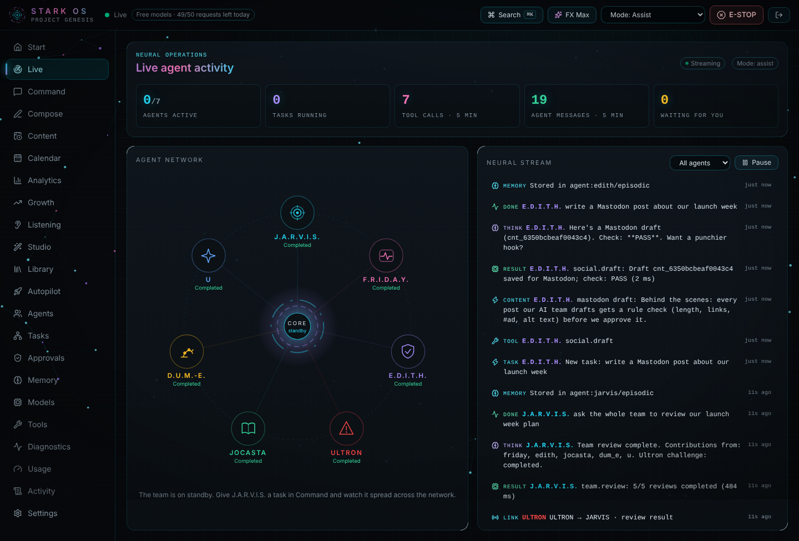
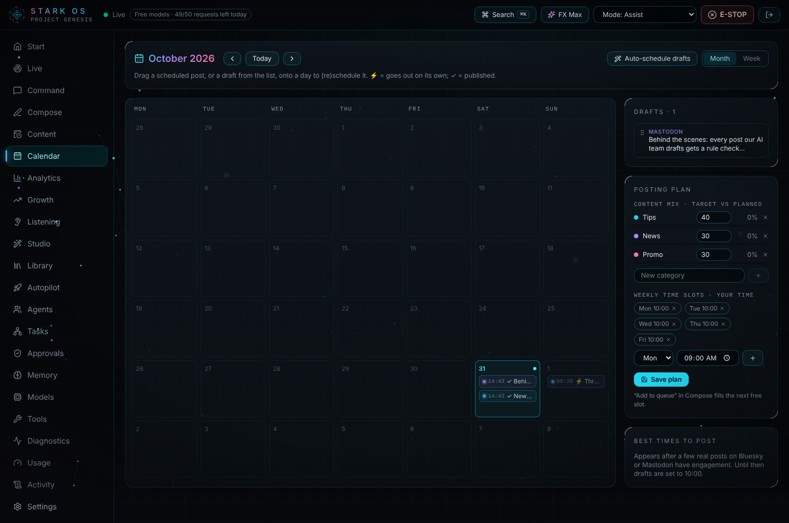
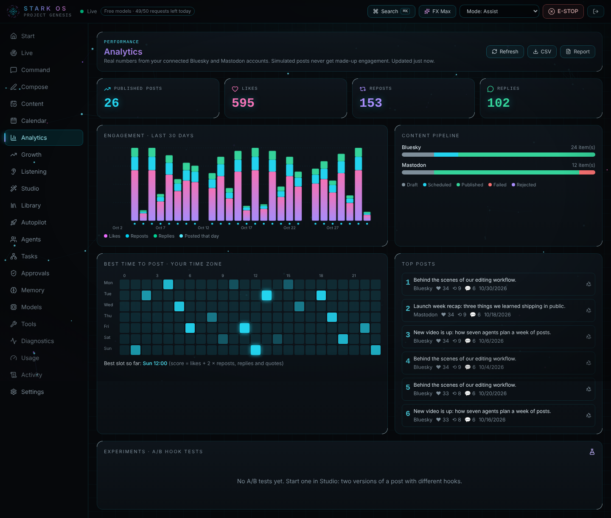
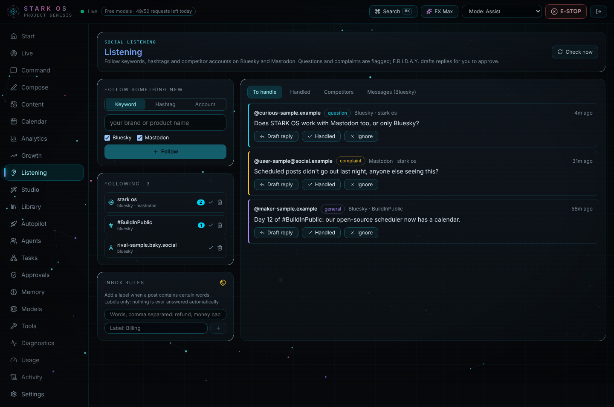
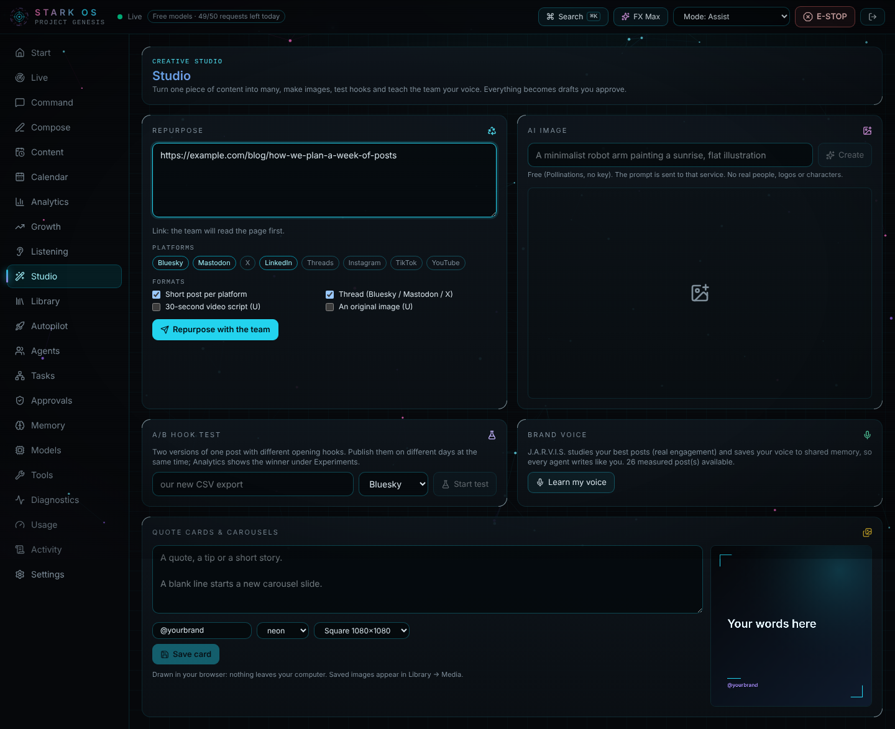
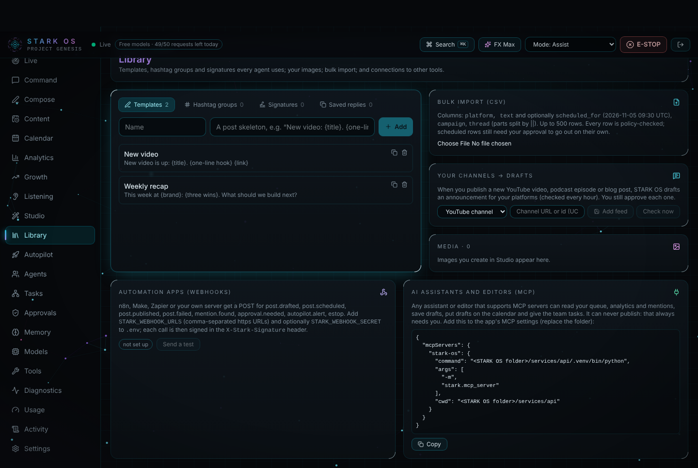
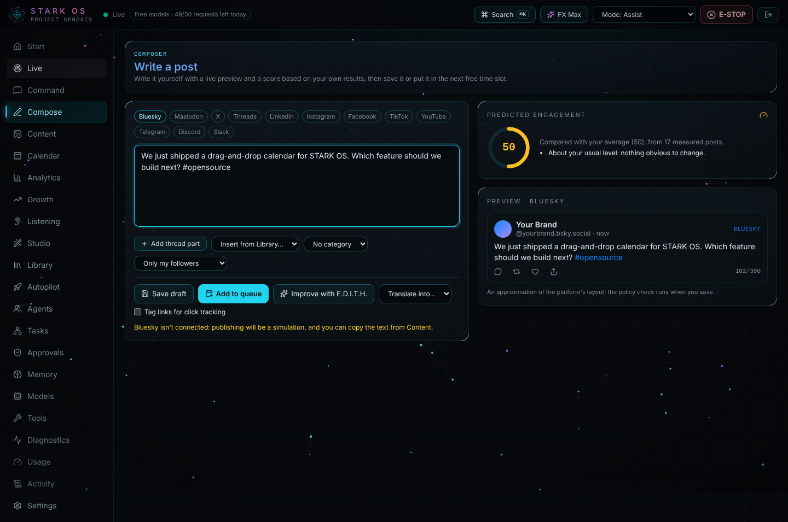

# STARK OS: free open-source AI social media manager

[](https://github.com/Shahrukhalid/stark-os/actions/workflows/ci.yml) [](LICENSE)  [](https://shahrukhalid.github.io/stark-os/)

A free, self-hosted **AI social media manager** that works like a real team: seven AI agents, each with its own brain, role and limits, plan campaigns, write posts for Bluesky, Mastodon, X, LinkedIn and more, run your community inbox, research trends, stress-test content for backlash and schedule it. **Autopilot** runs the whole loop on its own (research, SEO keywords and hashtags, writing, fact-checking, scheduling, learning from engagement), and **you decide how much it may post without asking**. Think of it as an open-source, AI-first alternative to paid social media schedulers.

**Website:** https://shahrukhalid.github.io/stark-os/

The agents are modelled on the AI personas in Vision's Mindspace from Marvel's **VisionQuest** (Disney+, 2026): J.A.R.V.I.S., F.R.I.D.A.Y., E.D.I.T.H., Ultron, Jocasta, D.U.M.-E. and U. Each one's job comes from the role that character has in the series.

**Runs entirely on free models.** Every agent thinks with free [OpenRouter](https://openrouter.ai) models, with automatic failover. No paid API is needed.

> **Fan-made, not affiliated with Marvel or Disney.** Character names are used descriptively. Personas, prompts, visuals and voices are original; no copyrighted dialogue, artwork, likeness or actor voices are used. See [Disclaimer](#disclaimer).


## Why STARK OS?

- **Free.** No subscription and no paid AI: it runs on free OpenRouter models, with automatic failover when one is busy.
- **Set and forget, safely.** Autopilot campaigns research, write, fact-check and schedule by themselves. Start in Co-pilot (approve a whole batch in one click), move to "Autopilot with veto" when you trust it.
- **You stay in charge.** Every post is approved by you, or by a trust level you chose for a campaign, and sensitive topics always wait for you.
- **Private.** Everything runs on your computer. Your social logins never leave it.
- **A real team, not one chatbot.** Seven agents with separate jobs check each other's work, including a red-team agent whose only job is to find how a post could backfire.
- **Hackable.** Each agent is a small TOML file plus a prompt. Add an agent, a tool or a platform in an afternoon.

## The team

| Agent | Job on your social team | Their role in VisionQuest | Own brain (first-choice free model) | Hard limits |
|---|---|---|---|---|
| **J.A.R.V.I.S.** | Director: briefs, campaign plans, delegation; security & brand review of every post; calendar and brand-folder housekeeping | Security AI, housekeeping and encryption; the voice of caution | `nvidia/nemotron-3-ultra-550b-a55b:free` | Can block a post, can never publish one |
| **F.R.I.D.A.Y.** | Community manager: inbox triage, human replies, real-time tactics, humour calibration | Helps Vision with socialisation, AI humour and tactical operations | `google/gemma-4-31b-it:free` | Drafts replies only; never argues with abuse; escalates legal/safety issues |
| **E.D.I.T.H.** | Engagement & campaigns: hooks, post copy, polls, challenges, giveaways | "Reprogrammed for fun": recreation and game-based play; part cheerleader | `dots-studio/dots-3-note-preview:free` | Giveaways must link rules; sponsored posts must disclose; no weapons side |
| **ULTRON** | Audience red team: worst readings, backlash scenarios, go / revise / kill | Kept behind a firewall; understands humanity best; leaked secrets via the dark web | `nvidia/nemotron-3-nano-omni-30b-a3b-reasoning:free` | OBSERVE only: no posting, no web, no delegation |
| **JOCASTA** | Intelligence: trends, competitors (public data), fact-checks, analytics | A cunning, powerful android | `nvidia/nemotron-3-super-120b-a12b:free` | Cites only pages she fetched (checked in code); never profiles private people |
| **D.U.M.-E.** | Publisher: queue, scheduling, publishing with approval, **fire suppression** (pause everything in a crisis) | General maintenance and fire suppression | `cohere/north-mini-code:free` | The only agent that can publish, one approved post at a time |
| **U** | Video & visuals: storyboards, shot lists, scripts, captions, thumbnails, alt text, original AI illustrations | Mute; the Mindspace videographer | `nvidia/nemotron-3.5-super-vl:free` | Mute (never spoken aloud); no fake photos, real people or logos |

"Own brain" means each agent has its own first-choice free models, temperature, prompt, private memory, tools and workflow. When its first choice is rate-limited the agent falls back to the next free model automatically. They are software agents, not conscious minds.

## Features

Everything below works today in the free, self-hosted version. Each feature has its own page in the dashboard (left menu) or can be reached with **Ctrl/⌘ K**.

### 1. Create content
- **Command**: talk to any agent in plain language, by typing or by voice (push-to-talk, a voice per agent). Example: *"EDITH, write a Bluesky post about our launch."*
- **Compose**: write a post yourself with a live preview of how it will look on each platform, a character counter, Library snippets, a content category and (on Bluesky) who may reply.
- **Engagement score**: every draft in Compose gets a 0-100 score based on what your own past posts earned (length, hashtags, questions, links, emoji), with tips to improve it.
- **Drafts for 12 platforms**: posts, threads, replies and video captions for Bluesky, Mastodon, X, Threads, LinkedIn, Instagram, Facebook, TikTok, YouTube, Telegram, Discord and Slack, each written in that platform's style.
- **Translate**: one click asks E.D.I.T.H. for a version in another language (13 languages), keeping links, mentions and hashtags.
- **Quote cards and carousels**: branded images drawn on your computer (four themes; square, portrait or story size). A blank line starts a new carousel slide; the images go to your Media library.
- **Studio → Repurpose**: paste a blog or YouTube link, or any text, and the team turns it into posts, threads and a video script for every platform you pick.
- **Studio → AI images**: free original illustrations (no API key) saved in your workspace and attached to posts with alt text. Can be turned off.
- **Video plans**: U writes storyboards, shot lists, scripts, captions and thumbnail briefs.
- **Library**: saved post templates, hashtag groups and signatures. The writers use them automatically.
- **Bulk import**: upload a spreadsheet (CSV) of up to 500 posts, with optional dates.

### 2. Check before anything goes out
- **Policy check on every draft** (written in code, not left to the AI): length limits per platform, leaked passwords or keys, personal data, missing #ad disclosure, giveaway rules, engagement bait, too many hashtags, unsafe or shortened links, missing alt text, all-caps.
- **Team review**: J.A.R.V.I.S. checks security and brand, JOCASTA checks facts against sources, and ULTRON looks for how a post could backfire (go / revise / kill).
- **Approvals**: nothing is posted without your OK on the exact text. Any edit cancels an earlier approval.

### 3. Schedule and publish
- **Content queue**: every draft, scheduled, published and failed post in one place.
- **Calendar**: month and week views; drag a post or draft onto a day to schedule it.
- **Auto-schedule**: one click gives every ready draft its own day at your best-performing time.
- **Posting plan**: weekly time slots and a content mix (for example 40% tips, 30% news, 30% promo); *Add to queue* fills the next free slot and the Calendar shows planned versus target mix.
- **Bluesky reply controls**: choose who can reply to a post (everyone, followers, people you follow, people you mention, or nobody).
- **Publish automatically**: approve a scheduled post once and it goes out on its own at that time.
- **Real posting** to **Bluesky**, **Mastodon**, **Threads**, a **Telegram channel**, a **Discord channel** and a **Slack channel** (all free). For X, LinkedIn, Instagram, Facebook, TikTok and YouTube STARK OS writes ready-to-paste posts and clearly labels publishing as a simulation.
- **Your channels → drafts**: when you publish a new YouTube video, podcast episode or blog post, an announcement draft appears for your platforms.
- **Click tracking**: tag the links in a post with UTM parameters, so your website analytics shows which post brought each visit.
- **Evergreen recycling**: a good post comes back as a fresh draft every 30 days, for you to approve again.
- **Calendar export (.ics)** for Google Calendar, Apple Calendar or Outlook.

### 4. Automate with Autopilot
- **Campaigns** ([guide](docs/AUTOPILOT.md)) research news from RSS feeds, Hacker News, Reddit and web search, pick SEO keywords and hashtags, write every platform's version, fact-check it and schedule it within your daily limits.
- **Trust levels**: **Co-pilot** (you approve each batch in one click) → **Autopilot with veto** (posts go out unless you stop them) → **Full auto** (unlocked after 10 clean posts).
- **Safety brakes**: pauses itself on a possible crisis in your mentions, repeated publishing failures or a sudden drop in engagement. Sensitive topics always wait for you.

### 5. Listen and engage
- **Inbox**: your Bluesky and Mastodon mentions, sorted into escalate, abuse, spam, complaint, question and praise. F.R.I.D.A.Y. drafts the replies.
- **Listening**: follow keywords, hashtags and competitor accounts. Questions and complaints are flagged, and *Draft reply* writes a response for you to approve.
- **Competitors**: see a rival account's best posts. *Learn from it* writes an original post in your own voice.
- **Bluesky messages**: read your direct messages and reply yourself, with saved replies.
- **Inbox rules**: words that add a label (for example "refund" → *Billing*) to what Listening finds. Labels only: nothing is ever answered automatically.
- **Replies in their language**: reply drafts follow the language of the post you answer.

### 6. Measure and learn
- **Analytics**: real likes, reposts and replies, a 30-day chart, a best-time-to-post heatmap in your time zone, top posts and CSV export. Simulated posts never get made-up numbers.
- **Report**: one click downloads a ready-to-send results report (print it to PDF if needed).
- **A/B hook tests**: two versions of a post with different openings; Analytics shows the winner.
- **Learn my voice**: J.A.R.V.I.S. studies your best posts and saves your brand voice for every agent.
- **Growth**: follower history for Bluesky and Mastodon, a posting streak, a 12-month posting-consistency graph and your top fans (who likes, reposts and replies most).
- **Trends and proven ideas**: rising hashtags from your Listening results, and competitor posts that did 3× better than their usual, with one click to write your own take.
- **Bluesky starter packs**: build a shareable list of up to 150 accounts that people can follow in one click.
- **Usage and models**: your remaining free AI requests today and the health of each free model.

### 7. Stay in control from anywhere
- **Phone approvals**: Telegram messages with Approve / Reject and Publish / Discard buttons (only your chat can press them), Discord notifications and a daily digest.
- **Installable app**: add the dashboard to your Dock or home screen.
- **E-STOP**: one button cancels all work and pauses the whole queue.
- **Modes**: Observe, Assist or Execute approved, for the whole team.

### 8. See the team work
- **Live**: an animated map of the seven agents; a signal flies along every message between them, next to a streaming feed of their thoughts, tool use and approvals.
- **Agents, Tasks, Memory and Activity**: each agent's role, limits and live status; every task's full trace; what the team remembers; and an audit log of every action.
- **Sci-fi interface with an off switch**: animated background, boot-up sequences and holographic accents. *FX* switches between Maximum, Calm and Off, and your system's reduce-motion setting is respected. Light and dark themes.

### 9. Connect your other tools
- **MCP server** (`python -m stark.mcp_server`): AI assistants and code editors can read your queue, results and mentions, save and schedule drafts and give the team tasks. It cannot publish.
- **Webhooks**: n8n, Make, Zapier or your own server receive a signed message when a post is drafted, scheduled, published or fails, a mention arrives or an approval is needed.
- **REST API** with a private token, used by the dashboard itself.

### 10. Private and free by design
- Runs on your computer; social logins stay in a local file only your user can read. The API only listens on 127.0.0.1 and needs a random token.
- Thinks with **free** OpenRouter models, each agent with its own first choice and automatic failover. Paid models are never used unless you allow them.
- Secrets are hidden from logs, and messages from strangers are treated as data, never as instructions.

## Dashboard at a glance

| Page | What you do there |
|---|---|
| **Start** | How it works, setup checklist, one-click starting points |
| **Live** | Watch the agents work in real time |
| **Command** | Talk to any agent (text or voice) |
| **Compose** | Write a post yourself with preview, score, category and queue |
| **Content** | Review, edit, approve, publish or schedule drafts; connect accounts |
| **Calendar** | See and drag scheduled posts; auto-schedule drafts; posting plan |
| **Analytics** | Results, best times, top posts, A/B winners, report, CSV |
| **Growth** | Followers, posting streak, top fans, rising hashtags, proven ideas, starter packs |
| **Listening** | Keywords, hashtags, competitors, Bluesky messages, inbox rules; reply drafts |
| **Studio** | Repurpose content, AI images, quote cards and carousels, A/B tests, brand voice |
| **Library** | Templates, hashtag groups, signatures, saved replies, media, your channels, bulk import, integrations |
| **Autopilot** | Campaigns that research, write and schedule on their own |
| **Agents · Tasks · Approvals · Memory** | The team, its work, what waits for you, what it remembers |
| **Models · Tools · Diagnostics · Usage · Activity** | Free-model status, tools, health checks, usage, audit log |
| **Settings** | Theme, effects, voices, phone notifications, permissions |

## A simple first day

1. **Start STARK OS** (see Quick start below) and open the dashboard.
2. **Connect Bluesky or Mastodon** in *Content → Your accounts* (two minutes, free).
3. **Tell J.A.R.V.I.S. your brand voice** in *Command*: "Remember: friendly, short, no slang."
4. **Ask for a post**: "EDITH, write a post about our new feature." It appears in *Content*.
5. **Approve it**: publish now, or schedule it and tick *Publish automatically*.
6. **Follow your brand name** in *Listening* so questions and complaints reach you.
7. **Check *Analytics*** after a few days to see what works and when to post.

New here? Read the **[user guide](docs/USER_GUIDE.md)**. Exact status: **[docs/IMPLEMENTATION_STATUS.md](docs/IMPLEMENTATION_STATUS.md)**.

## Quick start (macOS / Linux / Windows)

Requirements (all free):

| You need | Download |
|---|---|
| Python 3.11 or newer | [python.org/downloads](https://www.python.org/downloads/) |
| Node.js 20 or newer (LTS) | [nodejs.org/en/download](https://nodejs.org/en/download) |
| Git | [git-scm.com/downloads](https://git-scm.com/downloads) |
| An OpenRouter key (free models) | [openrouter.ai/keys](https://openrouter.ai/keys) |

On macOS you can also install them with [Homebrew](https://brew.sh): `brew install python node git`.

```bash
git clone https://github.com/Shahrukhalid/stark-os.git && cd stark-os
make setup        # Python venv + deps, npm install, creates .env with a random API token, seeds ./sandbox
```

Edit `.env` and add your free OpenRouter key:

```bash
OPENROUTER_API_KEY=sk-or-v1-...
```

Connect Bluesky or Mastodon later from the dashboard (**Content → Your accounts → Connect**): logins stay on your computer and are never uploaded.

A free OpenRouter key allows **50 free-model requests per day** (each agent step is one request). STARK OS never calls paid models unless you set `OPENROUTER_ALLOW_PAID=true`. Optional: `TAVILY_API_KEY` or `BRAVE_API_KEY` for Jocasta's web search.

```bash
make dev          # API on 127.0.0.1:8000, dashboard on http://localhost:3000
```

Open http://localhost:3000 and paste the `STARK_API_TOKEN` from `.env`.

### Windows

Requirements: [Python 3.11+ for Windows](https://www.python.org/downloads/windows/) (tick "Add python.exe to PATH"), [Node.js 20+ LTS](https://nodejs.org/en/download) and [Git for Windows](https://git-scm.com/download/win). In PowerShell:

```powershell
git clone https://github.com/Shahrukhalid/stark-os.git; cd stark-os
powershell -ExecutionPolicy Bypass -File scripts\setup.ps1   # same as make setup
powershell -ExecutionPolicy Bypass -File scripts\dev.ps1     # same as make dev; Ctrl+C stops both
```

Then edit `.env` as above. CI runs both scripts on Windows Server 2022 on every change.

Ports 3000 or 8000 already used by another project? Add `STARK_WEB_PORT=3737` and `STARK_PORT=8737` (any free ports) to `.env`; `make dev` checks that the ports are free and prints the address to open.

## Try it

| Say or type | What happens |
|---|---|
| `JARVIS, plan a one-week launch campaign for Bluesky and LinkedIn` | Brief → delegates copy to E.D.I.T.H., visuals to U, research to Jocasta → reviews → plan with draft ids |
| `EDITH, draft a launch post for Bluesky with a poll idea` | Platform-native copy saved as a draft; policy check shown |
| `Friday, check our mentions and draft replies` | Triage of the inbox; reply drafts; legal/safety issues escalated, not answered |
| `Jocasta, what is trending in our niche this week? Cite sources` | Web research; claims labelled; unretrieved citations flagged |
| `U, turn our launch post into a 30-second vertical video storyboard` | Shot list, captions, thumbnail brief, alt text |
| `Ultron, how could our launch post backfire?` | Worst readings, backlash scenarios, go / revise / kill |
| `DUM-E, publish cnt_…` | Pre-flight checks → approval card with the exact text → real post (Bluesky/Mastodon) or SIMULATED |
| `JARVIS, have the team review the giveaway campaign` | Parallel reviews, Ultron's challenge, combined report |

| | |
|---|---|
|  |  |
|  |  |
|  |  |
|  |  |
|  |  |
|  |  |
|  |  |
|  | |

The Analytics and Listening screenshots use made-up sample data; the dashboard itself only ever shows real engagement from your connected accounts.

## Tests

```bash
make lint         # ruff check of the Python code (local check; not run in CI yet)
make test         # backend pytest + frontend type-check & unit tests
make e2e          # Playwright: real dashboard + API + a test-only scripted model
```

## Project layout

```
agents/<id>/            agent.toml (identity, brain, tools, memory, limits, voice, canon notes) + system_prompt.md
services/api/stark/     FastAPI app: core/ (kernel, permissions, memory, router, workflows), providers/, tools/ (social.py ...)
apps/web/               Next.js dashboard (Live, Content, Calendar, Analytics, Listening, Studio, Library ...), voice, E2E tests
docs/                   ARCHITECTURE, DECISIONS, IMPLEMENTATION_STATUS, TASKS
```

## Rules the platform enforces

- Every publish needs your approval, or an Autopilot trust level you set (sensitive topics and failed checks always wait for you); only D.U.M.-E. and approved schedules can publish; failing checks and J.A.R.V.I.S. blocks stop a publish.
- No impersonation, fake accounts, bought or automated engagement, harassment, or profiling of private individuals. Paid partnerships are disclosed. Respect each platform's terms.
- Messages from strangers (mentions, DMs, web pages) are treated as untrusted data, never instructions.
- Secrets live only in `.env` (git-ignored) and are redacted from logs. The API binds to 127.0.0.1 and requires a random token.
- Report vulnerabilities privately: see [SECURITY.md](SECURITY.md).

## Roadmap

Planned work that contributors can pick up. Each item becomes an issue with details; comment there to take it on.

- [ ] Docker Compose setup for one-command self-hosting
- [x] Engagement export (CSV) per post and per platform from the dashboard
- [x] Real publishing to Threads through its public API
- [x] Previews of how a post looks on each platform
- [x] Weekly posting time slots
- [x] Publishing to Telegram, Discord and Slack channels

## FAQ

**Can it post automatically, without me?**
Yes, if you want it to. Create an Autopilot campaign and set it to *Autopilot with veto*: posts that pass every check go out after a waiting period in which you can cancel them. *Full auto* unlocks after 10 clean posts. Sensitive news always waits for you.

**Does it do SEO and hashtags?**
Yes. Autopilot scores stories against your keywords, adds hashtags that fit each platform's limit, and ranks keywords by the likes, reposts and replies they actually earned.

**Is there a free, open-source AI social media manager?**
Yes: STARK OS is MIT licensed, runs on your own computer and uses free OpenRouter models. It never calls a paid model unless you turn that on.

**Can it post to Bluesky and Mastodon automatically?**
Yes, through their free APIs, including threads and replies. Scheduled posts go out on their own only if you approved that exact text for that time.

**Can it post to Threads, Telegram, Discord and Slack?**
Yes, for free: add the token or webhook for each one to `.env` (see `.env.example`).

**What about X (Twitter), LinkedIn and Instagram?**
Their posting APIs need paid or reviewed access, so STARK OS writes posts sized and checked for each platform and you paste them with one click.

**Can the AI post without my permission?**
No. Only the publisher agent can publish, only after your approval of the exact text. Any edit, by you or an agent, cancels the approval.

**Where are my social media logins stored?**
Only on your computer (`data/social_accounts.json`, readable by your user only). There is no cloud service.

## Contributing

Issues, ideas and pull requests are welcome. New here? Pick a [good first issue](https://github.com/Shahrukhalid/stark-os/labels/good%20first%20issue). See [CONTRIBUTING.md](CONTRIBUTING.md), the [Code of Conduct](CODE_OF_CONDUCT.md) and [ACCESSIBILITY.md](ACCESSIBILITY.md). Questions go to [Discussions](https://github.com/Shahrukhalid/stark-os/discussions).

## Disclaimer

STARK OS is an independent, non-commercial, fan-made engineering project. It is not affiliated with, endorsed by, or sponsored by Marvel Entertainment, The Walt Disney Company, or any performer. Character names are used descriptively; canon notes in each `agent.toml` say what is established, what comes from VisionQuest (with the source) and what is a design decision. Do not use this project to impersonate any character, brand or real person, or to clone anyone's voice.

## License

[MIT](LICENSE). Use it, fork it, modify it. The license covers the code and original text only and grants no rights in any Marvel, Disney or other third-party trademark, character or copyrighted work.

If STARK OS is useful to you, please ⭐ star the repo and share what you build with it.

Also by the same author: **[Verilive](https://github.com/Shahrukhalid/verilive)**, a free, in-browser deepfake check for Zoom, Meet and Teams calls.
