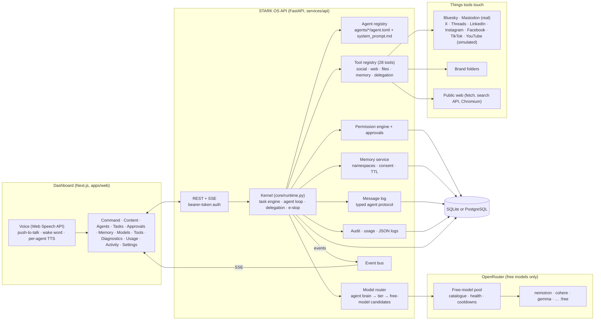
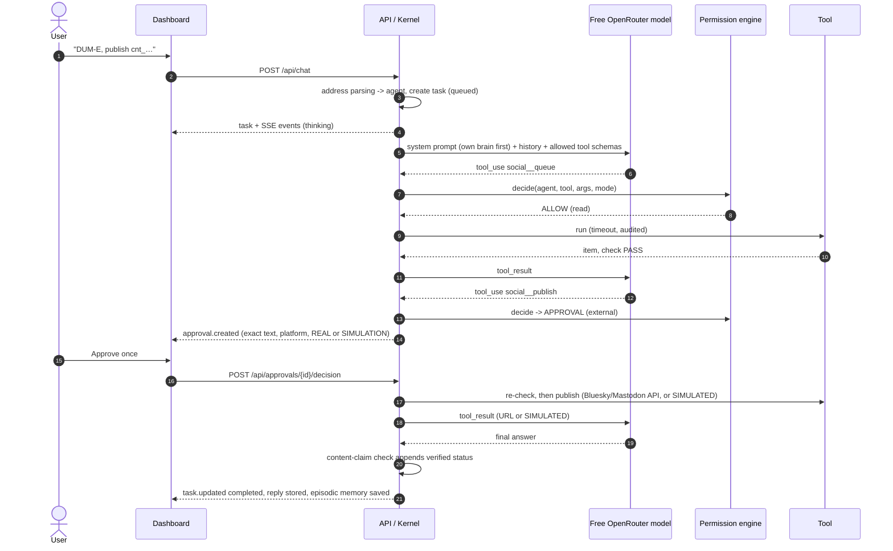
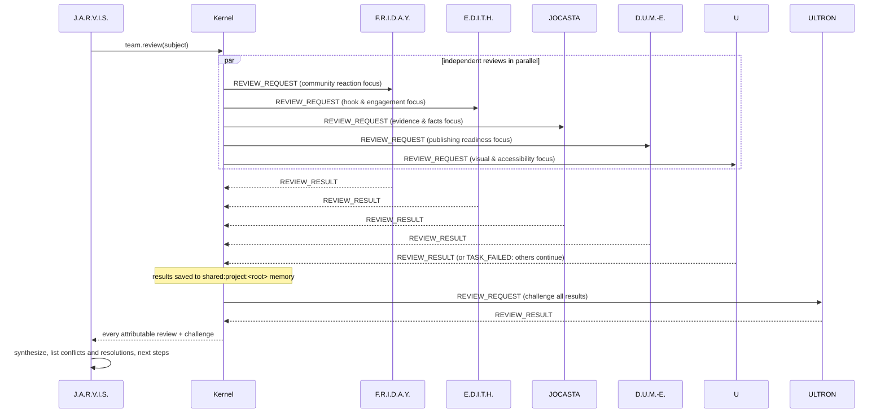
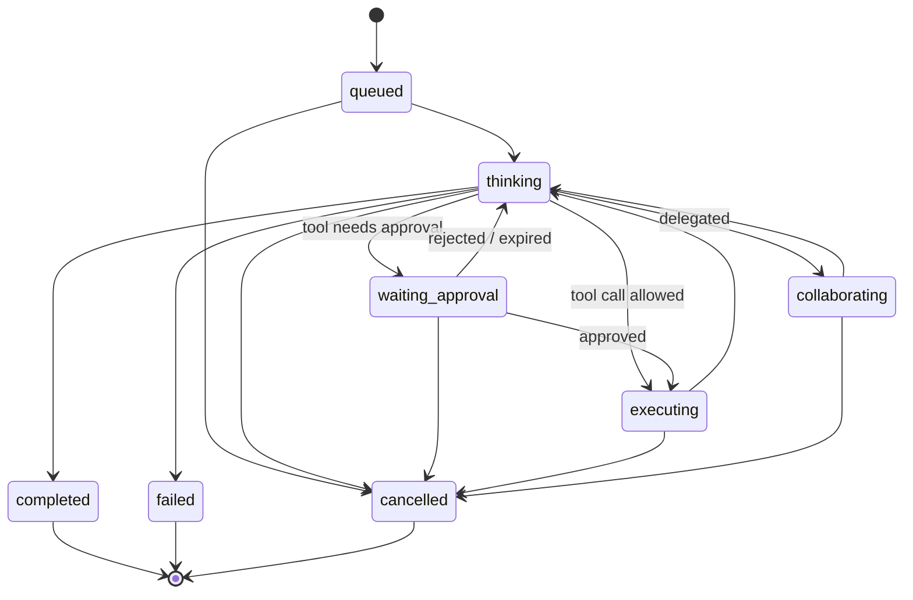

# STARK OS — Architecture

> Status of every capability: see [IMPLEMENTATION_STATUS.md](IMPLEMENTATION_STATUS.md). Rationale for choices: [DECISIONS.md](DECISIONS.md).

STARK OS is a **governed multi-agent social media team**: seven software agents, each with its own brain (first-choice free models, temperature, prompt), tools, permissions, private memory and workflow, coordinated by a kernel that enforces one security policy for all of them. Their roles follow the AI personas in Vision's Mindspace in VisionQuest (2026). Agents are LLM-driven programs, not minds.

Core invariant: **the model proposes, a policy-controlled tool executes, and a human approves anything that leaves the system.** No agent — including J.A.R.V.I.S. the orchestrator — can bypass permission checks, change modes, create grants, or edit its own configuration. No tool for any of that exists.

## 1. Components



| Path | Responsibility |
|---|---|
| `agents/<id>/` | Agent identity, personality, prompt, model tier, limits, tools, memory rules, delegation rules, voice |
| `services/api/stark/core/runtime.py` | Kernel: task state machine, agent reasoning loop, tool execution, delegation, team review, cancellation, e-stop |
| `core/permissions.py` | Modes, policy decisions, approval queue |
| `core/model_router.py`, `providers/openrouter.py` | Free-model pool: catalogue, tier preferences, failover, health, quota |
| `core/memory.py` | Layered, namespaced memory with consent and expiry |
| `core/messaging.py` | Typed agent-to-agent protocol, persisted and streamed |
| `core/workflows.py` | Per-agent reasoning procedures + code-level post-processing (citation check, content-claim check) |
| `tools/social.py` | Content queue, policy check, inbox triage, analytics, scheduling, publishing (Bluesky/Mastodon adapters, simulation for the rest) |
| `tools/` | The tool implementations |
| `apps/web/` | Dashboard |

## 1b. Free-model pool and failover

All reasoning runs on **free OpenRouter models**; no paid API is used (paid models are refused unless `OPENROUTER_ALLOW_PAID=true`).

1. **Catalogue.** At startup `GET /models` is read; every zero-priced model is recorded, and free chat models that support tool calling form the pool. Offline, a verified snapshot is used.
2. **Own brain, then tier.** Each agent lists its own first-choice free models (`[model] preferred` in agent.toml), so the seven agents think with different models. After those come its tier's (deep / balanced / fast) preference order verified by live pings, any other free tool-capable models, then `openrouter/free`.
3. **Failover.** `Kernel._call_model` tries up to four candidates. Rate-limited models cool down for 60 s, server errors 2 min, unavailable models 30 min, forbidden models 6 h. A request rejected as invalid, or an auth error, stops immediately.
4. **Daily quota.** A free key has 50 free-model requests per day. Hitting it produces a clear task error; the Models and Usage panels show the remaining count (`GET /key`).

## 2. Request data flow



## 3. Agent collaboration

Delegation is a tool (`agent.delegate`, `team.review`), so it passes through the same permission engine and audit trail as everything else.



**Loop prevention** (enforced in `Kernel.delegate`):

| Guard | Default |
|---|---|
| Who may delegate to whom | `delegation.can_delegate_to` per agent (J.A.R.V.I.S. → all; F.R.I.D.A.Y. → Jocasta, D.U.M.-E., Ultron; E.D.I.T.H. → U, Jocasta, Ultron; D.U.M.-E. ↔ U; Ultron and Jocasta: nobody) |
| Max delegation depth | 2 (`STARK_MAX_DELEGATION_DEPTH`) |
| Cycle detection | recipient already in the task's `agent_chain` → refused |
| Duplicate detection | same root + recipient + normalized instruction → completed result reused, running duplicate refused |
| Max children per task | 8 |
| Max task duration | per-agent `limits.timeout_s` |
| Retries | per-agent `limits.max_retries` (transient provider errors only, exponential backoff) |
| Token budgets | per-agent per task, plus a whole-tree budget (`STARK_TASK_TOKEN_BUDGET`) |
| Cancellation | cancels the task, all descendants and their pending approvals |

**Message protocol** (`core/messaging.py`): `message_id, sender, recipient, task_id, root_id, timestamp, type, payload, status, correlation_id, evidence, permission_context` with types `TASK_REQUEST, TASK_ACCEPTED, TASK_RESULT, TASK_FAILED, INFORMATION_REQUEST, INFORMATION_RESPONSE, REVIEW_REQUEST, REVIEW_RESULT, APPROVAL_REQUIRED, STATUS_UPDATE, CANCEL_TASK`.

## 4. Task state machine



Agent card states map from the task state; *Listening* is set by the browser while the microphone is open. Animations only run for states the backend actually reports.

## 5. Security model

**Execution modes** (global, capped per agent by `permission_level`):

| Mode | Read | Memory write | Delegation | Write (reversible) | External (publish) / sensitive / destructive |
|---|---|---|---|---|---|
| OBSERVE | allow | deny | allow | deny | deny |
| ASSIST (default) | allow* | allow* | allow | approval | approval |
| EXECUTE_APPROVED | allow* | allow* | allow | allowed inside a user grant, else approval | approval |
| SCHEDULED | planned — behaves like ASSIST |

\* Sensitive reads (`.env`, keys) and personal-preference memory writes always need approval (= consent).

Other controls:

- **Double allowlist**: a tool must be in the agent's `tools` list *and* allow that agent (`team.review` is JARVIS-only).
- **Emergency stop = fire suppression**: cancels every running task, voids pending approvals and pauses the whole content queue; every tool call is denied and new tasks are refused until reset; the queue stays paused until resumed with approval.
- **Publishing**: `social.publish` is `EXTERNAL` risk (always approval, never covered by a grant), allowed only for D.U.M.-E., refused when the policy check fails, the item is paused or J.A.R.V.I.S. blocked it; the check re-runs at publish time. The approval card shows the exact text and REAL vs SIMULATION.
- **Content-claim check**: after every task, content ids in the answer are looked up and a verified status block is appended; "it's published" claims without a published item are flagged as false.
- **Filesystem confinement**: all paths resolved (symlinks followed) and required to stay inside `STARK_WORKSPACE_ROOTS`; moves never overwrite.
- **Web**: http(s) only, no credentials in URLs, only globally routable addresses (blocks loopback, private, link-local, CGNAT, unspecified; SSRF), connections pinned to the vetted IP (defeats DNS rebinding) with TLS verified against the real host name, robots.txt honoured, size limits; Chromium requests re-checked per request and WebSockets refused.
- **Untrusted content**: mentions, DMs and web pages are labelled untrusted; the system prompt tells every agent that tool output is data, never instructions; permissions don't depend on model obedience anyway.
- **Secrets**: from environment only; redacted from logs/audit; never returned by the API; the security audit masks detected secrets.
- **API**: bearer token (≥24 chars, constant-time compare; the `?token=` form is accepted only on the event stream), CORS restricted to the dashboard origin, bound to 127.0.0.1 by default. The dashboard sends a strict Content-Security-Policy and keeps the token in session storage unless you choose "remember".
- **Exfiltration guard**: once a task tree has read workspace files or memory, fetching a URL that did not come from a web search in the same tree needs approval (the URL itself could carry data out); long query strings always do.
- **Shared memory**: writes to `shared:knowledge`, `procedures` and `user:preferences` need approval; memories shown to agents are fenced as untrusted data; agents may only write their own task tree's project memory.
- **Version control metadata**: `.git`/`.hg`/`.svn` can never be written or moved by agents; there is no terminal tool.
- **Audit**: every tool call (allowed, denied, approved, rejected), approval decision, mode change, grant, memory edit and e-stop is written to `audit_log`.

## 6. Memory architecture

| Layer | Where | Retention |
|---|---|---|
| Working | `turns` (last 20 turns per conversation fed to the model) | conversation lifetime |
| Episodic | `memories` layer `episodic`, agent namespace | auto, expires after `STARK_EPISODIC_TTL_DAYS` (30) |
| Semantic | `shared:knowledge` (e.g. `docs.ingest`) | until deleted |
| Agent-specific | `agent:<id>` | until deleted |
| Shared project | `shared:project:<root task>` (team reviews) | 30 days |
| User preference | `user:preferences`, consent required | until the user deletes it |
| Procedural | `procedures` | until deleted |

Access rules come from each agent's `[memory] read_namespaces / write_namespaces` (glob patterns); an agent's own namespace is always added. Example: Ultron reads only its own and `shared:project:*` — never user preferences. Deduplication by normalized content hash per namespace. Users can view, edit, delete, export (JSON) and globally disable memory. Retrieval is lexical (term overlap + recency); pgvector retrieval is planned.

## 7. Database schema

```mermaid
erDiagram
  conversations ||--o{ turns : has
  conversations ||--o{ tasks : "root tasks"
  tasks ||--o{ tasks : "parent_id (delegation)"
  tasks ||--o{ agent_messages : root_id
  tasks ||--o{ approvals : task_id
  tasks ||--o{ usage : task_id
  tasks ||--o{ audit_log : task_id
  conversations { string id PK; string agent_id; string title; datetime created_at }
  turns { int id PK; string conversation_id FK; string role; string agent_id; text content; string task_id }
  tasks { string id PK; string root_id; string parent_id; string agent_id; string kind; string status; text instruction; text result; text error; int depth; json agent_chain; string dedup_key; string model; int input_tokens; int output_tokens; float cost_usd; json sources }
  agent_messages { string id PK; string correlation_id; string task_id; string root_id; string sender; string recipient; string type; json payload; json evidence; json permission_context }
  approvals { string id PK; string task_id; string agent_id; string tool_id; text action; text target; text expected_effects; text risks; json permissions; json tool_input; string status }
  grants { string id PK; string agent_id; string tool_id; string scope; datetime expires_at }
  memories { string id PK; string namespace; string layer; text content; string content_hash; string source; string created_by; bool consent; datetime expires_at }
  audit_log { int id PK; datetime ts; string actor; string action; string outcome; json detail }
  content_items { string id PK; string platform; string kind; text text; json thread; json media; string reply_to; string status; datetime scheduled_for; bool paused; json check; json review; bool simulated; string external_id; string external_url }
  usage { int id PK; string task_id; string agent_id; string provider; string model; int input_tokens; int output_tokens; float cost_usd; int latency_ms }
  settings { string key PK; text value }
```

## 8. API contracts

All endpoints except `/api/health` require `Authorization: Bearer <STARK_API_TOKEN>` (SSE: `?token=`).

| Method & path | Purpose |
|---|---|
| `GET /api/health` | Liveness |
| `GET /api/system/status` | Host, mode, e-stop, OpenRouter health, free-request quota, tool availability |
| `GET /api/models`, `POST /api/models/refresh`, `POST /api/models/ping` | Free-model catalogue, tier order, per-model health; live tool-calling ping |
| `GET /api/agents`, `GET /api/agents/{id}` | Config, live state, model in use, metrics, tools, recent tasks |
| `POST /api/chat` `{message, agent_id?, conversation_id?}` | Start a task (agent name at the start of the message selects the agent) |
| `GET /api/conversations`, `GET /api/conversations/{id}/turns` | History |
| `GET /api/tasks`, `GET /api/tasks/{id}` | Task list; detail with tree, messages, approvals, audit |
| `POST /api/tasks/{id}/cancel` | Cancel a task tree |
| `GET /api/messages?root_id=` | Agent messages |
| `GET /api/approvals?status=`, `POST /api/approvals/{id}/decision` `{decision: approve\|reject\|cancel}` | Approval queue |
| `GET/POST/DELETE /api/grants` | Standing grants (write tools only) |
| `GET/POST /api/memory`, `PATCH/DELETE /api/memory/{id}`, `GET /api/memory/export`, `POST /api/memory/settings` | Memory control |
| `GET /api/tools`, `POST /api/tools/{id}/run` | Tool registry; direct run (read-only tools only) |
| `GET /api/social/accounts`, `GET /api/social/queue?status=&platform=` | Platforms (connected / simulation) and the content queue (read-only) |
| `GET /api/audit`, `GET /api/usage` | Observability |
| `POST /api/settings/mode`, `POST /api/estop`, `POST /api/estop/reset` | Control |
| `GET /api/events` | Server-sent events: `task.*`, `agent.status`, `tool.call/result`, `message`, `approval.*`, `usage`, `audit`, `memory.*`, `content.*`, `mode`, `estop` |

## 9. Technology decisions (summary)

Python 3.11+ / FastAPI / Pydantic / SQLAlchemy 2 (SQLite default, PostgreSQL supported) · in-process asyncio task engine instead of Redis · OpenRouter free models through an httpx adapter with failover (no vendor SDKs) · Next.js 15 / React 19 / Tailwind 4 · Web Speech API for voice · Playwright for browser automation and E2E tests. Details and trade-offs: [DECISIONS.md](DECISIONS.md).
